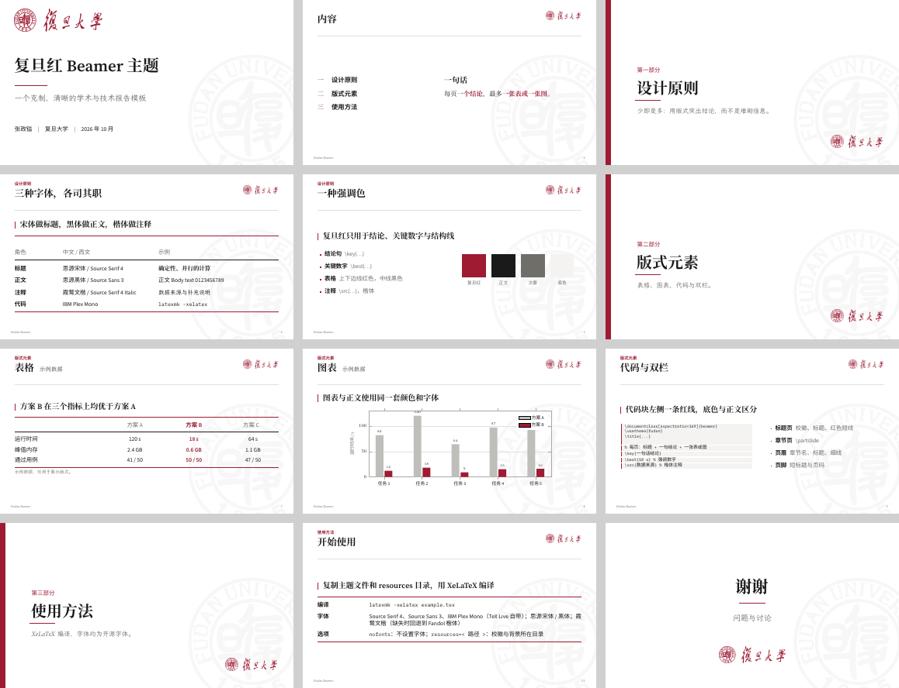

# fudan-beamer

一个克制、清晰的复旦红 Beamer 主题，适合学术报告与技术交流。
An unofficial, restrained Fudan-red Beamer theme for XeLaTeX.



## 设计原则

- **每页一个结论**：标题下方用 `\key{...}` 写出这一页要说的那句话，其余内容只是证据。
- **一种强调色**：复旦红（`#9E1B32`）只用于结论、关键数字与结构线，其余为黑白灰。
- **三种字体各司其职**：

  | 角色 | 中文 | 西文 |
  | --- | --- | --- |
  | 标题 | 思源宋体（Noto Serif CJK SC） | Source Serif 4 |
  | 正文 | 思源黑体（Noto Sans CJK SC） | Source Sans 3 |
  | 注释、副标题 | 霞鹜文楷（LXGW WenKai） | Source Serif 4 Italic |
  | 代码 | — | IBM Plex Mono |

- **表格**：booktabs 风格，上下边线为复旦红，中间分隔线为黑色。

## 快速开始

```sh
latexmk -xelatex example.tex
```

```latex
\documentclass[aspectratio=169,10pt]{beamer}
\usetheme{fudan}

\title[短标题]{报告标题}
\subtitle{副标题}
\author{作者}
\institute{单位}
\date{2026 年 10 月}

\begin{document}
\begin{frame}[plain]\titlepage\end{frame}

\partslide{第一部分}{章节标题}{一句话说明这一部分。}

\begin{frame}{页面标题}{可选副标题}
  \key{这一页的结论}
  ...
\end{frame}
\end{document}
```

把 `beamerthemefudan.sty` 和 `resources/` 复制到你的项目目录即可。

## 命令

| 命令 | 作用 |
| --- | --- |
| `\partslide{标签}{标题}{说明}` | 开始一个 `\section`，并生成章节页 |
| `\key{...}` | 页面的一句话结论（红色竖线 + 宋体加粗） |
| `\best{...}` | 需要强调的数字或短语（复旦红加粗） |
| `\pt{要点}{说明}` | 加粗要点 + 灰色说明 |
| `\hd{...}` | 页面内的小标题（宋体加粗） |
| `\colhead{...}` | 表格列标题（灰色） |
| `\src{...}` | 图表下方的楷体注释 |
| `\kai` | 切换到楷体（西文为衬线斜体） |

## 主题选项

- `\usetheme[nofonts]{fudan}`：不设置字体，使用你自己的字体配置。
- `\usetheme[resources=path/]{fudan}`：校徽与背景图片所在目录，默认 `resources/`。

## 字体

需要 XeLaTeX。Source Serif 4、Source Sans 3、IBM Plex Mono 与 Fandol 楷体随 TeX Live 提供；
思源宋体 / 思源黑体需安装 Noto CJK 字体；
[霞鹜文楷](https://github.com/lxgw/LxgwWenKai) 未安装时自动回退到 Fandol 楷体。

## 许可

Apache License 2.0。校徽与背景图片来自
[sonnyhcl/beamerthemefdu](https://github.com/sonnyhcl/beamerthemefdu)（Apache-2.0），详见 `NOTICE`。
本主题为非官方模板，复旦大学名称与校徽归复旦大学所有。
